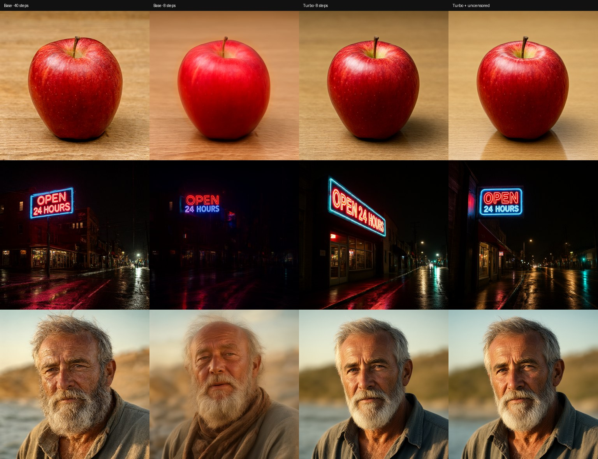
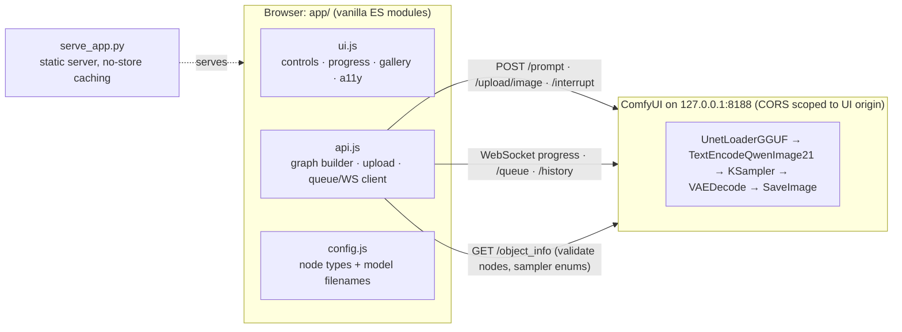

<div align="center">

# Qwen-Image-2.1 Playground

### Generate and edit images on your own GPU. No cloud, no build step, no dependencies.

A fast, private browser UI for **Qwen-Image-2.1**: text-to-image, instruction-based editing and the **8-step Turbo** model.
It runs on **AMD (ROCm)** and **Apple Silicon** through ComfyUI.


[](LICENSE)


</div>

---

## Why use it

- **Private and local.** Everything runs on your machine. Nothing leaves it.
- **Turbo is about 5x faster.** A 1024x1024 image takes ~13 s instead of ~69 s on an RX 7900 XTX, with quality close to the 40-step base model.
- **Text to image and image editing.** Drop in up to 16 reference images and write an instruction.
- **Nothing to install for the UI.** Plain HTML, CSS and ES modules. Start a small Python server and open a page.
- **Robust job tracking.** Progress, ETA, queue position, cancel, and recovery of results after a page reload.
- **Hardened for a local GPU server.** Scoped CORS, strict CSP, validated uploads.

[Qwen-Image-2.1](https://github.com/QwenLM/Qwen-Image-2.1) is a 7B diffusion transformer that does both text-to-image and image editing, with native text rendering. The model runs inside ComfyUI. This project is the application layer: graph construction, the edit pipeline, job tracking and recovery, and security hardening.

## Quickstart

1. **Install ComfyUI and the weights** (about 11 GB for the base model).

   | Platform | What to do |
   | --- | --- |
   | macOS (Apple Silicon) | `./scripts/setup_mac.sh`. See [docs/MACOS.md](docs/MACOS.md). |
   | Windows 11 + RX 7900 XTX | ComfyUI Desktop or portable, which selects ROCm automatically. See [docs/WINDOWS_AMD.md](docs/WINDOWS_AMD.md). |
   | Turbo, optionally the uncensored encoder | `scripts/setup_windows.ps1 [-Uncensored]` or `./scripts/setup_mac.sh [--uncensored]`. See [docs/TURBO.md](docs/TURBO.md). |

2. **Start ComfyUI** with CORS scoped to the UI origin.

   ```bash
   # macOS
   ./scripts/start_comfyui_mac.sh

   # Windows
   python main.py --port 8188 --use-pytorch-cross-attention --highvram --enable-cors-header http://127.0.0.1:8080
   ```

   `--highvram` stops ComfyUI from moving models out of GPU memory after each job, so repeat generations skip the reload. See [Memory behaviour](#memory-behaviour).

3. **Serve the UI** and open it.

   ```bash
   python scripts/serve_app.py
   ```

   Open <http://127.0.0.1:8080>. Press Cmd/Ctrl+Enter to generate.

> [!WARNING]
> Never start ComfyUI with a bare `--enable-cors-header`. It answers `Access-Control-Allow-Origin: *`, which lets any website you visit read your ComfyUI files and queue jobs.

Model filenames and node types are all in [`app/js/config.js`](app/js/config.js). Each preset lists candidate quants and the app uses the first one installed. Edit that file if your files are named differently.

### Memory behaviour

- **`--highvram`** keeps models resident in GPU memory between jobs instead of moving them out after each one.
- **Idle grace period.** After the last job finishes, the app waits 5 minutes and then asks ComfyUI to unload models and free VRAM. Submitting a new job cancels the timer. Change the delay with `IDLE_UNLOAD_MINUTES` in [`app/js/config.js`](app/js/config.js); `0` disables it.
- The timer runs in the browser, so it only works while the playground tab is open.

## Turbo vs base

Same prompts, same seed, 1024x1024, RX 7900 XTX. From left to right: base at 40 steps, base at 8 steps (what you get if you just cut the steps), **Turbo at 8 steps**, and Turbo with the uncensored encoder.



| Model | Steps | Time per image (warm) | What you get |
| --- | --- | --- | --- |
| Base | 40 | ~69 s | The reference quality |
| Base | 8 | ~15 s | Soft, washed-out and blurry. Fewer steps alone don't work. |
| **Turbo** | **8** | **~13 s** | **Close to base-40 quality, about 5x faster** |
| Turbo + uncensored encoder | 8 | ~140-300 s | Nearly identical to Turbo, but the 17.5 GB encoder overflows 24 GB of VRAM (~300 s default, ~140 s with `--highvram`, one run) |

Turbo only works with its own distilled sigma schedule, and the playground wires that up for you. See [docs/TURBO.md](docs/TURBO.md) for the details.

## Features

| Area | What you get |
| --- | --- |
| **Modes** | **Text to image**, and **Edit image**: drag and drop, browse or paste up to 16 reference images, then write an instruction. References go into `TextEncodeQwenImage21`'s `images` inputs, and that node's latent output seeds the sampler. |
| **Models** | Qwen-Image-2.1, **Turbo** (8-step distilled, fixed sigma schedule via `ManualSigmas` and `SamplerCustom`) and **Turbo + uncensored encoder**. Each preset uses the best quant installed and flags missing files. |
| **Validation** | On connect, the app checks `/object_info` for the required node types and fills the sampler and scheduler menus from the server's own lists. ComfyUI errors are shown verbatim. |
| **Jobs** | WebSocket progress with step count, ETA and queue position. Cancel works for a running or queued job, and an interrupt is sent only when the running job is yours. After a reload the app reconciles with the live queue and recovers missed results from `/history`. |
| **Server panel** | GPU name, free and total VRAM, ComfyUI and PyTorch versions. |
| **Gallery** | Lazy WebP thumbnails with Open / Copy prompt / Apply / Re-run / Download. Edits keep their reference images so a re-run reproduces them. |
| **Security** | CORS scoped to the UI origin, never `*`. A strict CSP limits connections to localhost:8188. No `innerHTML` or `eval` on server or user data. Uploads are raster-only, at most 20 MB each, renamed to a random filename and sent with `overwrite=false`. |
| **Accessibility** | ARIA live regions, focus management, contrast-checked controls and `prefers-reduced-motion` support. |

## Results

All runs use euler / simple / CFG 1.0 with an empty negative prompt and the GGUF `Q4_K_M` DiT.

| Image | Prompt | Size / steps | Hardware | Time |
| --- | --- | --- | --- | --- |
|  | a red apple on a wooden table, studio light | 512² / 8 | RX 7900 XTX, ROCm 7.2.1 | ~18.1 s cold (incl. ~14 s model load; ~0.6 s/step) |
|  | **edit:** "Change the apple to bright green, keep shape and background" | 512² / 8 | RX 7900 XTX, ROCm 7.2.1 | ~16.2 s warm |
|  | a red apple | 512² / 8 | M4 Pro 48 GB, MPS | ~116 s (incl. first model load) |
|  | cozy bookshop cafe… chalkboard reads "QWEN IMAGE 2.1" | 1024² / 40 | M4 Pro 48 GB, MPS | ~550 s (≈13.5 s/step) |

## Hardware guidance

| Hardware | DiT | Text encoder | Notes |
| --- | --- | --- | --- |
| Mac 24-48 GB unified | GGUF `Q4_K_M` (4.2 GB) | `qwen3vl_8b_w4a8` (6.3 GB) | used for the M4 Pro runs above; ~14 GB peak |
| Mac 64 GB+ unified | GGUF `Q8_0` (7.6 GB) | `w4a8` / `int8_convrot` | suggested, not measured |
| RX 7900 XTX 24 GB | GGUF `Q4_K_M` (measured); `Q6_K` (5.9 GB) / `Q8_0` also fit (the app picks whichever is installed) | `qwen3vl_8b_w4a8` | ~12-14 GB peak |
| **Turbo**, RX 7900 XTX | Turbo GGUF `Q8_0` (7.6 GB) | `qwen3vl_8b_w4a8` | measured: ~13 s per 1024² image warm, ~19 s cold |
| **Turbo**, Mac 48 GB | Turbo GGUF `Q6_K` (5.9 GB) | `qwen3vl_8b_w4a8` | ~15 GB, not measured |
| **Turbo + uncensored** | Turbo GGUF | `qwen3vl_8b_abliterated_bf16` (17.5 GB, built locally) | measured on the 7900 XTX: ~300 s per 1024² image, since the encoder offloads to RAM. See [details](docs/TURBO.md#memory) |

<!-- TODO: add a short GIF of a generation and an edit run -->

## Architecture

<details>
<summary>How the pieces connect</summary>



The app builds ComfyUI API graphs on the fly and drives them over ComfyUI's HTTP and WebSocket API. Turbo presets use `ManualSigmas` and `SamplerCustom` in place of `KSampler`.

</details>

## Roadmap

- [x] Add [Qwen-Image-2.1-Turbo](https://huggingface.co/Qwen/Qwen-Image-2.1-Turbo) as a second model
- [ ] Benchmark `Q6_K` / `Q8_0` vs `Q4_K_M` (speed and visual quality) on the same seeds
- [ ] NVIDIA / CUDA setup guide and timings
- [ ] Persist the gallery across sessions (IndexedDB)
- [ ] Inpainting / masked edit mode
- [ ] Small test suite for the graph builders (`buildGraph`, `buildEditGraph`)

## License

The playground code is MIT, see [LICENSE](LICENSE). **Qwen-Image-2.1 is released under the Qwen Research License**, which allows non-commercial use only unless you obtain a separate commercial license from Alibaba. A prioritized review of the code and the fixes it led to is in [docs/ANALYSIS.md](docs/ANALYSIS.md).

---

<details>
<summary><b>Español</b></summary>

**Qwen-Image-2.1 Playground** es una interfaz web para generar y editar imágenes en local con Qwen-Image-2.1. Está hecha con HTML, CSS y módulos ES, sin dependencias ni paso de compilación, y usa ComfyUI como motor. Funciona en **macOS (Apple Silicon)** y en **Windows 11 con AMD RX 7900 XTX (ROCm)**.

- **Dos modos:** texto a imagen, y edición de imagen a partir de referencias (arrastrar, examinar o pegar) más una instrucción.
- **Modelo Turbo:** versión destilada de 8 pasos. En la RX 7900 XTX genera una imagen de 1024×1024 en unos 13 s, frente a unos 69 s del modelo base con 40 pasos, con una calidad cercana. También hay un preset con el codificador de texto sin censura (experimental, mucho más lento en 24 GB de VRAM). Más detalles en [docs/TURBO.md](docs/TURBO.md).
- **Seguimiento de trabajos** por WebSocket, con pasos, tiempo estimado y cola. Puedes cancelar trabajos en curso o en cola, y los resultados se recuperan aunque recargues la página.
- **Seguridad:** CORS limitado al origen de la interfaz, CSP estricta y subidas validadas y renombradas con un nombre aleatorio.
- **Memoria:** en Windows se arranca ComfyUI con `--highvram` para que los modelos no salgan de la GPU entre trabajos. Tras 5 minutos sin trabajos, la app pide a ComfyUI que descargue los modelos y libere VRAM (`IDLE_UNLOAD_MINUTES` en `app/js/config.js`, `0` lo desactiva; solo funciona con la pestaña abierta).
- **Resultados medidos:** 512×512 con 8 pasos tarda unos 18 s en la RX 7900 XTX, incluida la carga del modelo. En un M4 Pro, 1024×1024 con 40 pasos tarda unos 550 s.

Inicio rápido: instala ComfyUI y los pesos (`./scripts/setup_mac.sh` o la guía de Windows), arranca ComfyUI con `--highvram --enable-cors-header http://127.0.0.1:8080`, ejecuta `python scripts/serve_app.py` y abre <http://127.0.0.1:8080>.

El código es MIT. El modelo usa la *Qwen Research License*, que solo permite uso no comercial.

</details>
