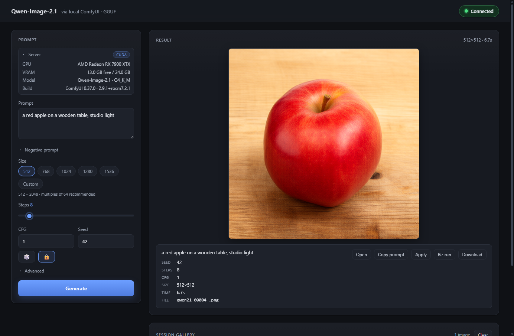
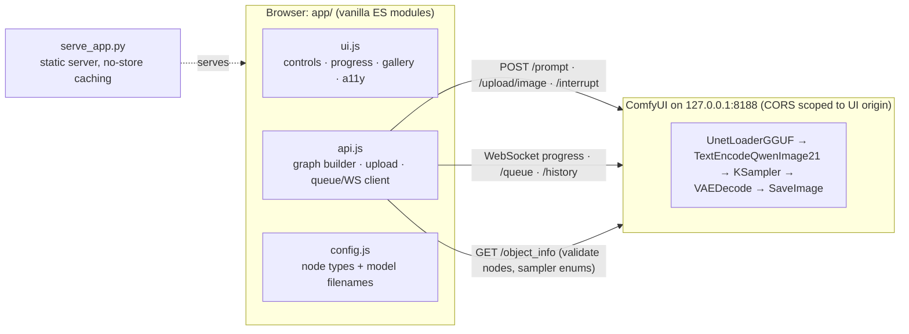
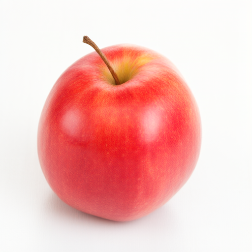

<div align="center">

# Qwen-Image-2.1 Playground

**A web UI with no dependencies for local text-to-image generation and instruction-based image editing with Qwen-Image-2.1. It runs on Apple Silicon and AMD GPUs through ComfyUI.**


[](LICENSE)




</div>

---

## What it is

[Qwen-Image-2.1](https://github.com/QwenLM/Qwen-Image-2.1) is a 7B diffusion transformer that handles both text-to-image and image editing, with native text rendering. This repo includes:

- **A browser playground** written in vanilla HTML, CSS and ES modules, with no build step and no external assets. It builds ComfyUI API graphs on the fly and drives them over ComfyUI's HTTP and WebSocket API.
- **Setup guides and scripts** for running the model locally with GGUF-quantized weights on **macOS (Apple Silicon)** and **Windows 11 + AMD RX 7900 XTX (ROCm)**.
- **Measured results**: real renders with prompt, seed, steps and timing for each.

The model runs inside ComfyUI. This project covers the application layer: graph construction, the edit pipeline, job tracking and recovery, and security hardening for a local GPU server.

## Architecture



## Features

- **Two modes:**
  - **Text → Image.**
  - **Edit image:** drag and drop, browse or paste up to 16 reference images, then write an instruction. References go into `TextEncodeQwenImage21`'s `images` inputs, and that node's latent output seeds the sampler.
- **Validated against the live server:** on connect, the app checks `/object_info` for the required node types and fills the sampler and scheduler menus from the server's own lists. ComfyUI errors are shown verbatim.
- **Job tracking that survives reloads:**
  - WebSocket progress with step count, ETA and queue position.
  - Cancel works for a running or a queued job. An interrupt is sent only when the running job is yours.
  - After a reload, the app reconciles with the live queue and recovers results it missed, using the `/history` endpoint.
- **A server panel** showing the GPU name, free and total VRAM, and the ComfyUI and PyTorch versions.
- **A session gallery** with lazy WebP thumbnails and Open / Copy prompt / Apply / Re-run / Download actions. Edits keep their reference images so a re-run reproduces them.
- **Hardened for a local GPU server:**
  - CORS is scoped to the UI origin, never `*`.
  - A strict CSP limits connections to localhost:8188.
  - No `innerHTML` or `eval` on server or user data.
  - Uploads are raster-only, at most 20 MB each, renamed to a random filename and sent with `overwrite=false`.
- **Accessible:** ARIA live regions, focus management, contrast-checked controls and support for `prefers-reduced-motion`.

## Quickstart

1. **Install ComfyUI and the weights** (about 11 GB):
   - **macOS:** `./scripts/setup_mac.sh`. See [docs/MACOS.md](docs/MACOS.md).
   - **Windows 11 + RX 7900 XTX:** ComfyUI Desktop or portable, which selects ROCm automatically. See [docs/WINDOWS_AMD.md](docs/WINDOWS_AMD.md).
2. **Start ComfyUI** with CORS scoped to the UI origin:
   ```bash
   ./scripts/start_comfyui_mac.sh
   # Windows:
   python main.py --port 8188 --use-pytorch-cross-attention --enable-cors-header http://127.0.0.1:8080
   ```
3. **Serve the UI:** run `python scripts/serve_app.py`, then open <http://127.0.0.1:8080>. Press ⌘/Ctrl+Enter to generate.

> [!WARNING]
> Never start ComfyUI with a bare `--enable-cors-header`. It answers `Access-Control-Allow-Origin: *`, which lets any website you visit read your ComfyUI files and queue jobs.

Model filenames and node types are all in [`app/js/config.js`](app/js/config.js). Edit that file if your files are named differently or you use another quant.

## Results

All runs use euler / simple / CFG 1.0 with an empty negative prompt and the GGUF `Q4_K_M` DiT.

| Image | Prompt | Size / steps | Hardware | Time |
| --- | --- | --- | --- | --- |
|  | a red apple on a wooden table, studio light | 512² / 8 | RX 7900 XTX, ROCm 7.2.1 | ~18.1 s cold (incl. ~14 s model load; ~0.6 s/step) |
|  | **edit:** "Change the apple to bright green, keep shape and background" | 512² / 8 | RX 7900 XTX, ROCm 7.2.1 | ~16.2 s warm |
|  | a red apple | 512² / 8 | M4 Pro 48 GB, MPS | ~116 s (incl. first model load) |
|  | cozy bookshop cafe… chalkboard reads "QWEN IMAGE 2.1" | 1024² / 40 | M4 Pro 48 GB, MPS | ~550 s (≈13.5 s/step) |

### Which quant fits your machine

| Hardware | DiT | Text encoder | Notes |
| --- | --- | --- | --- |
| Mac 24-48 GB unified | GGUF `Q4_K_M` (4.2 GB) | `qwen3vl_8b_w4a8` (6.3 GB) | used for the M4 Pro runs above; ~14 GB peak |
| Mac 64 GB+ unified | GGUF `Q8_0` (7.6 GB) | `w4a8` / `int8_convrot` | suggested, not measured |
| RX 7900 XTX 24 GB | GGUF `Q4_K_M` (measured); `Q6_K` (5.9 GB) / `Q8_0` also fit (set `UNET_GGUF` to match) | `qwen3vl_8b_w4a8` | ~12-14 GB peak |

<!-- TODO: add a short GIF of a generation and an edit run -->

## Roadmap

- [ ] Add [Qwen-Image-2.1-Turbo](https://huggingface.co/Qwen/Qwen-Image-2.1-Turbo) as a second model
- [ ] Benchmark `Q6_K` / `Q8_0` vs `Q4_K_M` (speed and visual quality) on the same seeds
- [ ] NVIDIA / CUDA setup guide and timings
- [ ] Persist the gallery across sessions (IndexedDB)
- [ ] Inpainting / masked edit mode
- [ ] Small test suite for the graph builders (`buildGraph`, `buildEditGraph`)

## License

The playground code is MIT, see [LICENSE](LICENSE). **Qwen-Image-2.1 is released under the Qwen Research License**, which allows non-commercial use only unless you obtain a separate commercial license from Alibaba. A prioritized review of the code and the fixes it led to is in [docs/ANALYSIS.md](docs/ANALYSIS.md).

---

<details>
<summary><b>🇪🇸 Español</b></summary>

**Qwen-Image-2.1 Playground** es una interfaz web para generar y editar imágenes en local con Qwen-Image-2.1. Está hecha con HTML, CSS y módulos ES, sin dependencias ni paso de compilación, y usa ComfyUI como motor. Funciona en **macOS (Apple Silicon)** y en **Windows 11 con AMD RX 7900 XTX (ROCm)**.

- **Dos modos:** texto a imagen, y edición de imagen a partir de referencias (arrastrar, examinar o pegar) más una instrucción.
- **Seguimiento de trabajos** por WebSocket, con pasos, tiempo estimado y cola. Puedes cancelar trabajos en curso o en cola, y los resultados se recuperan aunque recargues la página.
- **Seguridad:** CORS limitado al origen de la interfaz, CSP estricta y subidas validadas y renombradas con un nombre aleatorio.
- **Resultados medidos:** 512×512 con 8 pasos tarda unos 18 s en la RX 7900 XTX, incluida la carga del modelo. En un M4 Pro, 1024×1024 con 40 pasos tarda unos 550 s.

Inicio rápido: instala ComfyUI y los pesos (`./scripts/setup_mac.sh` o la guía de Windows), arranca ComfyUI con `--enable-cors-header http://127.0.0.1:8080`, ejecuta `python scripts/serve_app.py` y abre <http://127.0.0.1:8080>.

El código es MIT. El modelo usa la *Qwen Research License*, que solo permite uso no comercial.

</details>
